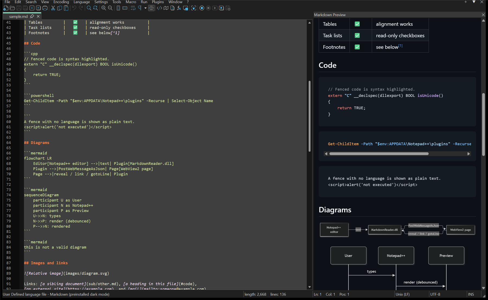
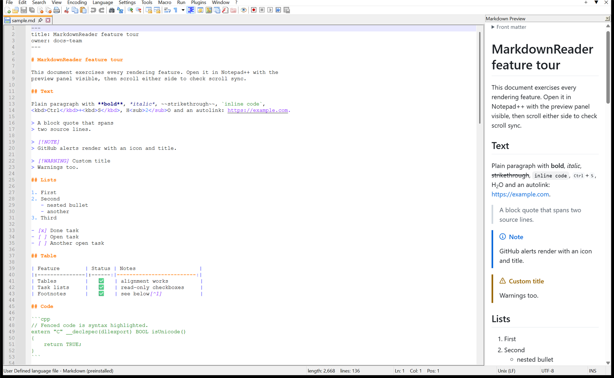
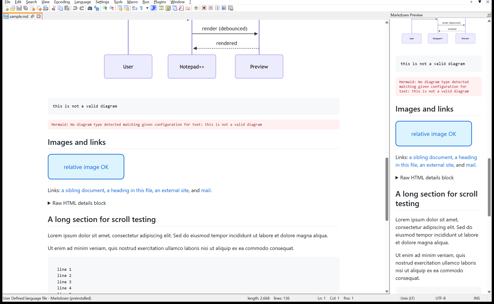
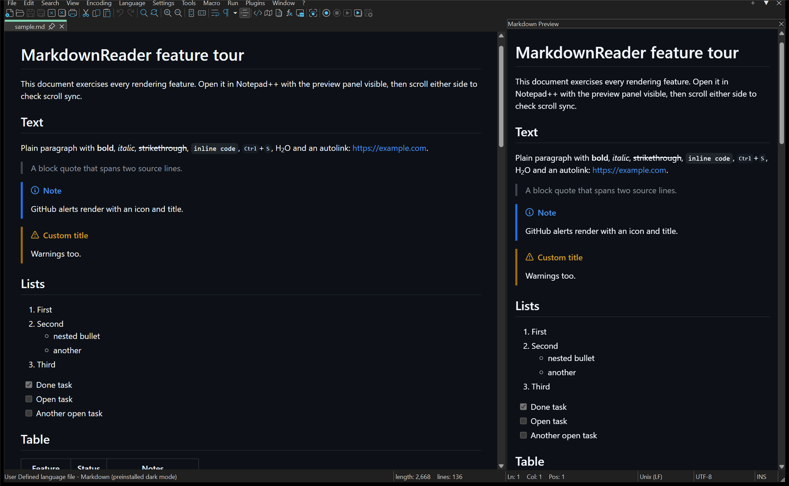
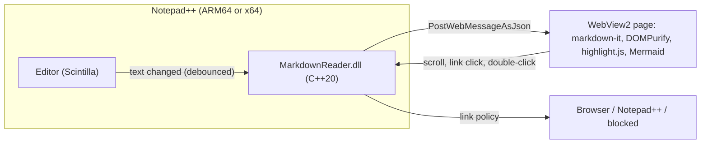

<div align="center">



<h1>
  
  MarkdownReader for Notepad++
</h1>

<h3>Your <code>.md</code> files deserve better than raw asterisks.<br/>
Live preview + full reading mode, native on <b>ARM64</b> and <b>x64</b>.</h3>

[](https://github.com/rsalinger/NotepadPlusPlus-Markdown/releases)
[](#-native-on-windows-on-arm)
[](https://notepad-plus-plus.org/)
[](LICENSE)

[](https://github.com/rsalinger/NotepadPlusPlus-Markdown/releases)
[](https://github.com/rsalinger/NotepadPlusPlus-Markdown/commits/main)
[](https://github.com/markdown-it/markdown-it)
[](https://mermaid.js.org/)

</div>



<table align="center">
  <tr>
    <td align="center" width="50%">
      <a href="https://github.com/rsalinger/NotepadPlusPlus-Markdown/releases/download/v0.1.0/MarkdownReader-arm64.zip" aria-label="Download MarkdownReader for ARM64">
        
      </a>
    </td>
    <td align="center" width="50%">
      <a href="https://github.com/rsalinger/NotepadPlusPlus-Markdown/releases/download/v0.1.0/MarkdownReader-x64.zip" aria-label="Download MarkdownReader for x64">
        
      </a>
    </td>
  </tr>
</table>

<p align="center">📦 <b>These are plugin zips, not installers.</b> <a href="#-installation">Here's the two-minute setup.</a></p>

> **Notepad++ is the editor you already love. MarkdownReader is the part that finally makes `README.md` *readable*.**
> One native DLL, zero .NET, zero background services. Open a Markdown file and it just... renders.

> [!NOTE]
> **v0.1.0 is an early preview.** The core (panel, reading mode, scroll sync, diagrams, dark mode) is verified on
> Notepad++ 8.9.8.1 for ARM64 and x64. A few features are built but still waiting for hands-on testing; the
> [feature list](#-complete-feature-list) says exactly which.

---

##  What is MarkdownReader?

MarkdownReader is a **native C++ plugin** that turns Notepad++ into a proper Markdown reader. It renders your
document with the same engine family as Microsoft Edge (WebView2), so tables, task lists, syntax-highlighted code and
**Mermaid diagrams** look the way they do on GitHub, right next to the source or instead of it.

It was born on a **Windows on ARM** laptop, where the classic Markdown plugins simply refuse to load: they're x64-only
.NET assemblies, and an ARM64 Notepad++ can't host them. So this one is native from day one, for ARM64 *and* x64.

<details>
<summary><b>📖 Why another Markdown plugin?</b></summary>

<br/>

- **ARM64.** When this project started, the ARM64 Plugin Admin list had *zero* Markdown previewers.
- **Reading mode.** Most previewers give you a side panel. Lots of us mostly *read* Markdown (runbooks, design docs,
  READMEs) and want the whole editor area rendered, one keystroke away.
- **Safety.** Markdown previewers have shipped bugs where opening a crafted `.md` file could launch programs. This
  one was designed so the preview can *show* a document but never *run* anything (see [Secure by design](#-secure-by-design)).
- **Modern rendering.** GitHub-flavored Markdown, GitHub alerts, Mermaid 12, highlight.js, light and dark themes.

</details>

---

##  Feature showcase

###  Live preview panel

Open a `.md` file and a **Markdown Preview** panel docks itself next to the editor. Type, and it re-renders (debounced,
so even multi-megabyte docs stay smooth). Pick **Language → Markdown** on any file, even an unsaved one, and it lights up too.



###  Reading mode

**Toggle Reading Mode** and the editor area itself becomes the rendered document, at the exact spot you were
reading. Toggle again, or **double-click any paragraph**, to jump back into the source at that line. Turn on
*Open Markdown in Reading Mode* and `.md` files open as documents, not code.

<table>
  <tr>
    <td></td>
    <td></td>
  </tr>
</table>

###  Scroll sync that actually syncs

Every rendered block knows which source lines it came from, so the editor and preview stay locked together, even
inside long code fences and diagrams (a classic pain point). Scroll either side and the other follows.

###  Diagrams, code and GitHub-flavored everything

Tables, task lists, footnotes, front matter, `[!NOTE]` alerts, autolinks, raw HTML like `<details>` and `<kbd>`,
syntax highlighting for 40+ languages, and **Mermaid** flowcharts, sequence diagrams, state charts and more. Mermaid's
5.5 MB engine loads only when a document actually has a diagram, and a broken diagram shows a friendly error instead of
taking the page down.

###  Secure by design

> A previewer should **show** your document. It should never **run** it.

- **Sanitized:** rendered HTML goes through DOMPurify; scripts, event handlers and `javascript:` links never survive.
- **Locked down:** a strict Content-Security-Policy, no navigation, no new windows, no downloads, no permission prompts.
- **Links go through a policy, not `ShellExecute`:** `http(s)` and `mailto` open in your browser, local text and
  Markdown files open in Notepad++, and *everything else is blocked* (`.exe`, `.cmd`, `shell:`, `file:`, ...).
- **Images only:** the plugin serves only image, audio and video files from your document's folder, and only regular
  files on disk.
- **Proven:** a hostile test document ([`tests/manual/xss.md`](tests/manual/xss.md)) and 100+ unit assertions guard all
  of the above.

###  Native on Windows on ARM

Built with MSVC for **ARM64** and **x64** (x86 builds too), statically linked: no VC++ redistributable, no
`WebView2Loader.dll`, no .NET. Snapdragon X, Surface Pro, Windows Dev Kit: it runs at native speed.

---

##  Complete feature list

✅ verified in Notepad++ 8.9.8.1 (ARM64 + x64) · 🧪 built, needs hands-on testing · 🗺️ planned

<table>
<tr><td valign="top" width="50%">

#### Preview & reading
| | Feature |
|---|---|
| ✅ | Docked live preview, auto-opens for Markdown |
| ✅ | Detects `.md`, `.markdown`, `.mdown`, ... |
| 🧪 | *Language → Markdown* renders any file |
| ✅ | Re-renders while you type |
| ✅ | Reading mode over the editor, per document |
| ✅ | Editor → preview scroll sync |
| 🧪 | Preview → editor scroll sync |
| 🧪 | Double-click to jump to the source line |
| ✅ | Panel restored when Notepad++ restarts |

</td><td valign="top" width="50%">

#### Rendering
| | Feature |
|---|---|
| ✅ | GitHub-flavored Markdown + alerts + footnotes |
| ✅ | Front matter (collapsed) |
| ✅ | Syntax highlighting (40+ languages) |
| ✅ | Mermaid diagrams, with friendly errors |
| ✅ | Relative images from the document folder |
| 🧪 | `../` images and UNC network shares |
| ✅ | Light & dark, following Notepad++ |
| 🧪 | Your own `custom.css` |

</td></tr>
<tr><td valign="top">

#### Getting things out
| | Feature |
|---|---|
| 🧪 | Export to HTML (standalone, styles inlined) |
| 🧪 | Export to PDF |
| 🧪 | Print |
| 🧪 | Copy rendered HTML (pastes into Outlook / Teams) |

</td><td valign="top">

#### Living inside Notepad++
| | Feature |
|---|---|
| 🧪 | Notepad++ shortcuts work while the preview has focus |
| 🧪 | Links: browser / Notepad++ / blocked |
| ✅ | Portable Notepad++ friendly |
| 🗺️ | Native Markdown syntax highlighting (Language menu) |

</td></tr>
</table>

---

##  Installation

> [!IMPORTANT]
> **MarkdownReader is a Notepad++ plugin, not an app.** There's no setup program and nothing to double-click: you put
> a folder inside Notepad++'s `plugins` folder and Notepad++ loads it the next time it starts. It takes about two
> minutes, and every download includes these steps as `INSTALL.txt`.

**You'll need:** Notepad++ **8.7.7 or newer** and the Microsoft Edge **WebView2 Runtime** (already part of
Windows 11; on Windows 10 it comes with Edge).

1. **Pick the right zip.** In Notepad++, open **? → About Notepad++** and look at the first line:

   | It says | Download |
   |---|---|
   | **(ARM 64-bit)** | [MarkdownReader-arm64.zip](https://github.com/rsalinger/NotepadPlusPlus-Markdown/releases/download/v0.1.0/MarkdownReader-arm64.zip) |
   | **(64-bit)** | [MarkdownReader-x64.zip](https://github.com/rsalinger/NotepadPlusPlus-Markdown/releases/download/v0.1.0/MarkdownReader-x64.zip) |

2. **Close Notepad++.**
3. **Unblock the zip.** Right-click it → **Properties** → tick **Unblock** (if it's shown) → **OK**. Windows can refuse
   to load DLLs that came from the internet; unblocking the zip *before* extracting avoids that.
4. **Create the plugin folder** `C:\Program Files\Notepad++\plugins\MarkdownReader\`. Windows will ask for
   administrator permission; that's expected. Using a portable Notepad++? Create
   `<your Notepad++ folder>\plugins\MarkdownReader\` instead.
5. **Copy everything from the zip into that folder**, so that you end up with:

   ```text
   plugins\
   └── MarkdownReader\
       ├── MarkdownReader.dll      ← must be directly in here
       ├── web\
       ├── INSTALL.txt
       ├── LICENSE
       └── THIRD_PARTY_NOTICES.txt
   ```

> [!WARNING]
> Windows' **Extract All** adds an extra folder level (`MarkdownReader\MarkdownReader-arm64\MarkdownReader.dll`), and
> Notepad++ won't find the plugin there. If that happens, move the files up one level.

6. **Start Notepad++ and open any `.md` file.** 🎉 The **Markdown Preview** panel docks on the right, and everything
   else is under **Plugins → MarkdownReader**.

> [!TIP]
> On a first run Notepad++ docks new panels quite narrow. Drag the panel's edge to give it room; Notepad++ remembers.

<details>
<summary><b>Troubleshooting and uninstalling</b></summary>

<br/>

| What you see | What to do |
|---|---|
| "Cannot load ARM64 plugin" or "Cannot load 64-bit plugin" | You installed the zip for the other architecture; see step 1. |
| No **MarkdownReader** under the **Plugins** menu | The DLL isn't directly inside `plugins\MarkdownReader\` (step 5), or it's still blocked (step 3). |
| A message that the **WebView2 Runtime** is missing | Install it from [Microsoft](https://developer.microsoft.com/microsoft-edge/webview2/), then restart Notepad++. |

**Uninstall:** close Notepad++ and delete the `plugins\MarkdownReader` folder.

</details>

---

##  Using it

Everything lives under **Plugins → MarkdownReader**. Bind any of these to keys in *Settings → Shortcut Mapper*.

| Command | What it does |
|---|---|
| **Toggle Preview Panel** | Show or hide the docked live preview |
| **Toggle Reading Mode** | Render the current document over the editor (works on *any* document, if you insist) |
| **Sync Scrolling** | Keep editor and preview scrolled together |
| **Open Markdown in Reading Mode** | Markdown files open rendered instead of as source |
| **Export to HTML... / PDF... / Print...** | Take the rendered document with you |
| **Copy Rendered HTML** | Put rich HTML on the clipboard |
| **Settings...** | Open the settings file in Notepad++ (saving it applies the changes) |

##  Settings

`MarkdownReader.ini` lives in your plugin config folder (`%APPDATA%\Notepad++\plugins\Config`):

| Key | Default | Meaning |
|---|---|---|
| `extensions` | `md markdown mdown mkd mkdn mdwn mdx` | Files treated as Markdown |
| `autoOpenPanel` | `1` | Open the panel when a Markdown file is activated |
| `syncScroll` | `1` | Scroll sync between editor and preview |
| `readingModeByDefault` | `0` | Open Markdown files in reading mode |
| `theme` | `auto` | `auto` follows Notepad++ dark mode, or `light` / `dark` |
| `allowRemoteImages` | `1` | Load `https://` images (turn off to block tracking pixels) |
| `mermaid` | `1` | Render Mermaid diagrams |
| `customCss` | *(empty)* | Path to your own stylesheet (default `...\Config\MarkdownReader\custom.css`) |
| `devTools` | `0` | F12 developer tools in the preview, for troubleshooting |

---

##  How it works



<sub>Yes, that diagram is Mermaid. MarkdownReader renders it too.</sub>

<details>
<summary><b>The architecture in a few sentences</b></summary>

<br/>

The DLL listens to Notepad++ and Scintilla notifications, reads the document (converting legacy code pages to UTF-8),
and posts it as JSON to a bundled page running in WebView2. The page renders with markdown-it, tags every block with its
source lines for scroll sync, sanitizes with DOMPurify and patches the DOM with morphdom, so updates don't flicker or lose
your place. The page is served from a private virtual host; the document's own images come from a second, read-only
origin mapped to its folder. One WebView2 environment is shared by the panel and the reading views, with its profile in
`%LOCALAPPDATA%` (or next to a portable Notepad++).

</details>

---

##  Building from source

<details>
<summary><b>Prerequisites and commands</b></summary>

<br/>

- Visual Studio 2022 (or Build Tools) with **Desktop development with C++**, the **ARM64** and **x64/x86** MSVC
  tools, and the **Windows 11 SDK**
- Node.js 22+

```powershell
git clone https://github.com/rsalinger/NotepadPlusPlus-Markdown.git
cd NotepadPlusPlus-Markdown

# Sandbox: portable Notepad++ copies in .npp-dev\ (your installed Notepad++ is never touched)
scripts\setup-dev.ps1

# Build the plugin + preview page, deploy into the sandbox, and launch it
scripts\deploy-dev.ps1 -Launch -File tests\manual\sample.md

# Release zips (MarkdownReader-arm64.zip, MarkdownReader-x64.zip) in build\dist
scripts\package.ps1
```

**Tests:** `cd web; npm test` (renderer, sanitizer XSS corpus, scroll-sync math) and
`build\Debug\ARM64\NativeTests.exe` (URL mapping, link policy, messages, clipboard).

**Preview page without Notepad++:** `cd web; npm run build:dev; node dev/serve.mjs`, then open
`http://localhost:5178/?file=sample.md`. A `devHost` object in the console plays the plugin's part.

| Path | What lives there |
|---|---|
| `src/` | The plugin: Notepad++ integration, WebView2 hosting, panel, reading overlay |
| `src/core/` | Pure, unit-tested logic: URL ↔ file mapping, link policy, messages |
| `src/npp/` | Vendored Notepad++ plugin headers (GPL-3.0-or-later) |
| `web/` | The preview page: rendering, sanitizing, scroll sync, export |
| `tests/` | Native unit tests and manual test documents |
| `scripts/` | Sandbox setup, deploy, install, packaging |

</details>

---

##  Roadmap

- [x] **v0.1:** live preview, reading mode, scroll sync, Mermaid, dark mode, native ARM64 + x64
- [ ] Hands-on verification of export, print, links and shortcuts → **v0.2**
- [ ] Toolbar buttons, a settings dialog and an x86 release
- [ ] CI builds on GitHub Actions (ARM64 runners included)
- [ ] Native Markdown syntax highlighting with its own *Language* menu entry
- [ ] Ideas welcome: open an issue!

##  Contributing

Bug reports, ideas and pull requests are all welcome. If you're on Windows on ARM, you're especially wanted: tell us
what works on your machine. For security problems, please don't open a public issue: report them privately through the repository's
**Security → Report a vulnerability** page.

##  License

[GPL-3.0-or-later](LICENSE), like Notepad++ itself. Release zips include `THIRD_PARTY_NOTICES.txt` with the licenses of
everything bundled.

##  Acknowledgements

Standing on the shoulders of [Notepad++](https://notepad-plus-plus.org/) by Don Ho, Microsoft
[WebView2](https://developer.microsoft.com/microsoft-edge/webview2/),
[markdown-it](https://github.com/markdown-it/markdown-it), [DOMPurify](https://github.com/cure53/DOMPurify),
[Mermaid](https://mermaid.js.org/), [highlight.js](https://highlightjs.org/),
[morphdom](https://github.com/patrick-steele-idem/morphdom),
[github-markdown-css](https://github.com/sindresorhus/github-markdown-css) and
[nlohmann/json](https://github.com/nlohmann/json). The logo uses the public-domain
[Markdown mark](https://github.com/dcurtis/markdown-mark).

<div align="center">
<br/>
<br/>
<sub>Made for people who read more Markdown than they write.</sub>
</div>
