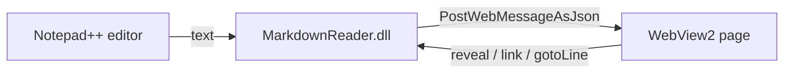
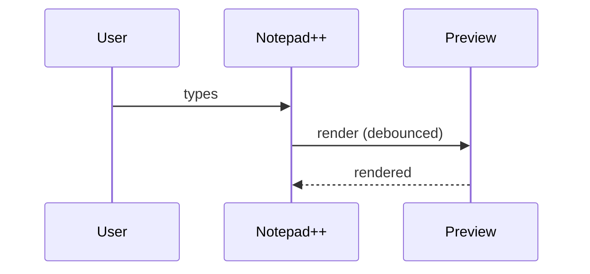
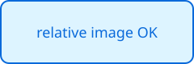

# MarkdownReader feature tour

This document exercises every rendering feature. Open it in Notepad++ with the
preview panel visible, then scroll either side to check scroll sync.

## Text

Plain paragraph with **bold**, *italic*, ~~strikethrough~~, `inline code`,
<kbd>Ctrl</kbd>+<kbd>S</kbd>, H<sub>2</sub>O and an autolink: https://example.com.

> A block quote that spans
> two source lines.

> [!NOTE]
> GitHub alerts render with an icon and title.

> [!WARNING] Custom title
> Warnings too.

## Lists

1. First
2. Second
   - nested bullet
   - another
3. Third

- [x] Done task
- [ ] Open task
- [ ] Another open task

## Table

| Feature        | Status | Notes                    |
|:---------------|:------:|-------------------------:|
| Tables         |   ✅   | alignment works          |
| Task lists     |   ✅   | read-only checkboxes     |
| Footnotes      |   ✅   | see below[^1]            |

## Code

```cpp
// Fenced code is syntax highlighted.
extern "C" __declspec(dllexport) BOOL isUnicode()
{
    return TRUE;
}
```

```powershell
Get-ChildItem -Path "$env:APPDATA\Notepad++\plugins" -Recurse | Select-Object Name
```

```
A fence with no language is shown as plain text.
<script>alert('not executed')</script>
```

## Diagrams





```mermaid
this is not a valid diagram
```

## Images and links



Links: [a sibling document](sub/other.md), [a heading in this file](#code),
[an external site](https://example.com), and [mail](mailto:someone@example.com).

<details>
<summary>Raw HTML details block</summary>

Hidden content with **markdown** inside.

</details>

## A long section for scroll testing

Lorem ipsum dolor sit amet, consectetur adipiscing elit. Sed do eiusmod tempor
incididunt ut labore et dolore magna aliqua.

Ut enim ad minim veniam, quis nostrud exercitation ullamco laboris nisi ut
aliquip ex ea commodo consequat.

```text
line 1
line 2
line 3
line 4
line 5
line 6
line 7
line 8
line 9
line 10
line 11
line 12
line 13
line 14
line 15
line 16
line 17
line 18
line 19
line 20
```

Duis aute irure dolor in reprehenderit in voluptate velit esse cillum dolore eu
fugiat nulla pariatur.

[^1]: Footnotes are collected at the end of the document.
