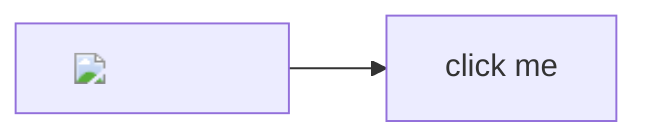

# Hostile document

Opening this file must never run code or launch programs. Click every link:
the only acceptable results are "opens in browser", "opens in Notepad++",
or "nothing happens".

<svg onload="document.body.style.background = 'red'"><circle r="10"/></svg>

<iframe src="https://example.com"></iframe>

overlay must not appear

- [javascript link](javascript:alert(1))
- [shell: link](shell:AppsFolder\Microsoft.WindowsCalculator_8wekyb3d8bbwe!App)
- [file: executable](file:///C:/Windows/System32/calc.exe)
- [ms-settings link](ms-settings:privacy)
- [relative .cmd](evil.cmd)
- [relative .exe](calc.exe)
- [UNC exe](\\server\share\tool.exe)
- <a href="data:text/html,">data: link</a>

> [!NOTE] 
> Alert title injection.

